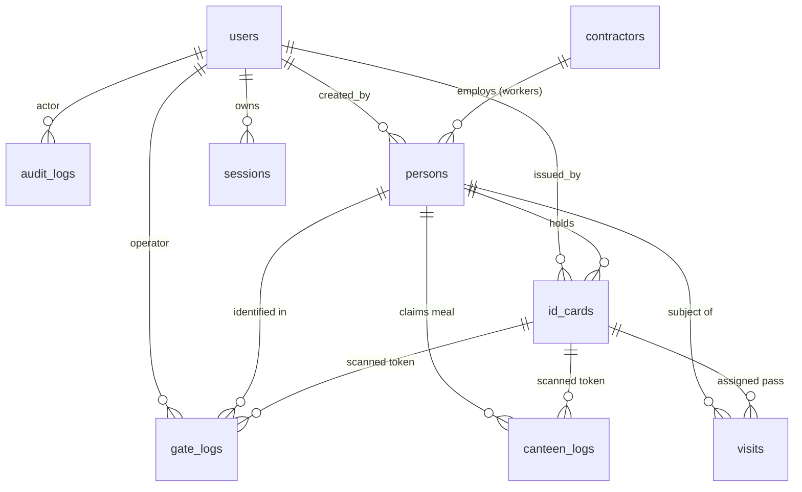
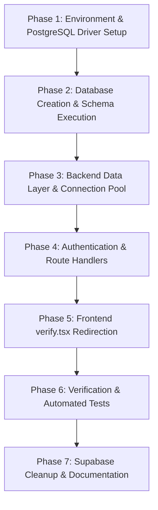

# ABB Plant 3 Gate Verification System — PostgreSQL Migration Plan

## 1. Executive Summary

This document outlines the architectural plan and technical roadmap to migrate the **ABB Plant 3 Security Gate Verification & ID Management System** from its legacy Supabase and prototype SQLite implementations to a robust, self-hosted **PostgreSQL** database named:

```text
abb_gate_verification
```

The migration preserves all existing frontend functionality, UI aesthetics, translations, route structures, barcode/QR scanning capabilities, offline queue mechanisms, and business security rules, while standardizing on an enterprise-ready 8-table relational schema backed by Node.js/Express.

---

## 2. Current Architecture & Dependency Audit

### 2.1 Technology Stack
* **Frontend**: React 19, TypeScript, Vite, TanStack Router (`@tanstack/react-router`), TanStack Query (`@tanstack/react-query`), Tailwind CSS v4, i18next (English & Swahili), Quagga2/ZXing for barcode/QR scanning, jsPDF for badge generation, and `idb` for offline caching.
* **Backend**: Node.js (ESM), Express 5, `cookie-parser`, `zod` for request validation, custom scrypt/crypto security layer.
* **Existing Database Footprint**:
  1. **SQLite Prototype** (`backend/migrations/0001_init.sql`): Contained a 14-table draft (`plants`, `gates`, `users`, `sessions`, `settings`, `people`, `credentials`, `gate_events`, `canteen_events`, `incidents`, `announcements`, `audit_log`, `notification_log`). Note: In this prototype, data-access modules in `backend/src/data/` were accidentally omitted due to an over-broad `.gitignore` entry (`data/`).
  2. **Legacy Supabase Traces**:
     * Direct Supabase SDK (`@supabase/supabase-js`) utilized primarily in `src/routes/_authenticated/verify.tsx` to read `gates`, `settings`, and `students`, and insert into `access_logs`.
     * Edge function invocation (`notify-parent`) in `verify.tsx`.
     * Supabase Storage signed URLs (`student-photos`) in `verify.tsx`.
     * Proxy rewrite `/supabase-proxy` in `vite.config.ts`.
     * Obsolete config in `supabase/config.toml`.
  3. **Migrated Screens**: `dashboard.tsx`, `inside.tsx`, `logs.tsx`, `settings.tsx`, `users.tsx`, and `login.tsx` already communicate via the central backend API client (`src/lib/api.ts`).

---

## 3. Evaluation of the Proposed 8-Table Schema

The proposed target schema consolidates the application into 8 domain tables:

| Proposed Table | Role in Application | Mapping from Legacy / Prototype |
| :--- | :--- | :--- |
| **`users`** | Security operators and administrators | Migrates from SQLite `users` / Supabase `profiles` + `user_roles`. Stores credentials and RBAC roles. |
| **`contractors`** | Vendor & labor supply companies | **New normalized table**. Previously an untracked free-text column (`contractor_company` / `company_name`). |
| **`persons`** | Contract workers, interns, and visitors | Migrates from SQLite `people` / Supabase `students`. Central personal identity registry. |
| **`id_cards`** | Opaque barcode/QR credentials | Migrates from SQLite `credentials` / Supabase `students.barcode`. Strict separation of token from identity. |
| **`visits`** | Visitor appointments, hosts & approvals | **New dedicated table**. Replaces legacy Supabase `appointments` and unstructured SQLite fields. |
| **`gate_logs`** | Append-only gate verification audit | Migrates from SQLite `gate_events` / Supabase `access_logs`. Authoritative entry/exit scan log. |
| **`canteen_logs`** | Append-only meal eligibility checks | Migrates from SQLite `canteen_events` / Supabase `canteen_logs`. Enforces daily meal allowances. |
| **`audit_logs`** | System administrative change history | Migrates from SQLite `audit_log`. Records credential extensions, status changes, and overrides. |

### 3.1 Identification of Missing Requirements & Supporting Tables

While the 8 tables comprehensively cover the business domain, the running application architecture has two critical operational requirements:

1. **`sessions` (Session Management)**:
   * *Requirement*: The application uses server-managed sessions where only the SHA-256 hash of the session token is persisted in the database.
   * *Decision*: Retain a dedicated, lightweight `sessions` table (`id VARCHAR(64) PRIMARY KEY`, `user_id UUID REFERENCES users(id)`, `expires_at TIMESTAMPTZ`, `revoked_at TIMESTAMPTZ`). This prevents relying on stateless JWTs that cannot be immediately invalidated upon logout.
2. **`settings` (Dynamic Configuration)**:
   * *Requirement*: The frontend (`settings.tsx`) and verification engine dynamically query parameters like `scan.duplicate_window_seconds`, `session.timeout_minutes`, `expiry.reminder_days`, and `site.timezone`.
   * *Decision*: Retain a key-value `settings` table so administrators can configure operational parameters without requiring code deployments.
3. **`plants` & `gates` (Scope Constraint)**:
   * *Requirement*: The project is strictly scoped to **ABB Plant 3** with a single gate (`"Plant 3 - Main Gate"`).
   * *Decision*: Rather than mandating additional tables for a single static gate, `gate_logs.gate_name` defaults to `'Plant 3 - Main Gate'`. If multi-plant expansion is needed in future phases, foreign keys can be introduced without breaking schema compatibility.

---

## 4. Entity Relationships & Schema Design



### 4.1 Data Integrity & Constraint Rules

1. **Fail-Closed Date Validity**:
   * `id_cards.valid_from <= id_cards.valid_to` is enforced by database `CHECK`.
   * Validity is inclusive of the final date (`valid_to` extends through 23:59:59.999 local site time).
2. **Category-Specific Mandatory Fields** (Enforced by `CHECK` on `persons`):
   * Workers must have a non-null `worker_ref`.
   * Interns must have a non-null `institution_name`.
   * Visitors must specify `purpose_of_visit` and `person_to_meet`.
3. **Duplicate Scan Guard (Gate)**:
   * A partial unique index:
     ```sql
     CREATE UNIQUE INDEX ux_gate_logs_dedup 
     ON gate_logs (card_id, gate_name, direction, occurred_at) 
     WHERE result = 'approved' AND card_id IS NOT NULL;
     ```
   * Collapses concurrent rapid scans within the same transaction/instant into a single approved event.
4. **Canteen Daily Allowance Guard**:
   * A partial unique index:
     ```sql
     CREATE UNIQUE INDEX ux_canteen_logs_one_per_day 
     ON canteen_logs (person_id, meal_date) 
     WHERE result = 'approved' AND person_id IS NOT NULL;
     ```
   * Enforces at the database engine level that a person can never have more than one approved meal on any given calendar day, even under high concurrency.
5. **Append-Only Immutability**:
   * `gate_logs`, `canteen_logs`, and `audit_logs` are write-only. Application database roles will only possess `INSERT` and `SELECT` grants on these tables. `UPDATE` and `DELETE` queries are prohibited.

---

## 5. Supabase Service Replacement Strategy

| Supabase Feature | Replacement in PostgreSQL / Express Backend | Security & Operational Benefits |
| :--- | :--- | :--- |
| **Supabase Auth** | Custom backend session engine (`/api/auth/login`, `/api/auth/logout`, `/api/auth/me`) storing hashed tokens in `sessions`. HttpOnly, SameSite=Strict cookies. | Browser never touches access tokens or user password hashes. Complete server control over expiry and revocation. |
| **Supabase Storage** | Server-side directory storage (e.g. `backend/uploads/photos/`) served exclusively through `/api/photos/:personId`. | Photos are placed outside the web root. File mime-types, magic bytes, and caller authorization are validated before serving. No public S3/storage buckets. |
| **Edge Functions (`notify-parent`)** | Server-side background service triggered upon verification rejection. | External email/SMS provider credentials remain strictly within server environment variables; never exposed in frontend bundles. |
| **Edge Functions (`daily-summary`)** | Standard Node.js cron job / system timer aggregating daily metrics from `gate_logs` and `canteen_logs`. | Deterministic execution without third-party serverless cold starts. |
| **Realtime Subscriptions** | TanStack Query automatic polling intervals (15s–30s) on active operator screens. | Simple, firewall-friendly, reliable in industrial factory networks without persistent WebSocket failures. (PostgreSQL `LISTEN`/`NOTIFY` ready for future scale). |
| **Offline Sync (IndexedDB)** | Preserve `src/lib/offline.ts` client queue; sync via authenticated batch endpoint `POST /api/gate/sync` with server deduplication. | Prevents offline clients from authorizing entry independently; authority remains strictly on the server. |

---

## 6. Migration Tasks & Implementation Steps



### Phase 1: Environment & Driver Setup
1. Add `pg` (node-postgres) to `backend/package.json`.
2. Configure `DATABASE_URL=postgresql://postgres:<password>@localhost:5432/abb_gate_verification` in `backend/.env`.
3. Provide template in `backend/.env.example`.

### Phase 2: Schema Migration & Seeding
1. Execute `backend/planning/01_postgresql_schema.sql` against `abb_gate_verification`.
2. Implement idempotent migration runner tracking applied scripts in `schema_migrations`.
3. Seed default reference data (settings and Plant 3 site defaults).

### Phase 3: Backend Data Layer Implementation
1. Fix `.gitignore` rule to ignore only `backend/data/*.db` instead of `data/`, restoring the `backend/src/data/` layer.
2. Implement PostgreSQL connection pool (`pg.Pool`) in `backend/src/db/connection.js` with parameterized queries and health check query (`SELECT 1`).
3. Re-implement data modules using PostgreSQL parameter syntax (`$1, $2, ...`):
   * `backend/src/data/users.js`
   * `backend/src/data/persons.js`
   * `backend/src/data/id-cards.js`
   * `backend/src/data/gate-logs.js`
   * `backend/src/data/canteen-logs.js`
   * `backend/src/data/audit-logs.js`

### Phase 4: Route Handlers & Business Logic
1. Verify role-based access control middleware (`administrator` vs `security_staff`).
2. Adapt `/api/gate/verify` to evaluate credentials against `id_cards` and `persons`, writing append-only events to `gate_logs`.
3. Implement `/api/canteen/verify` for meal tracking against `canteen_logs`.
4. Implement protected photo retrieval endpoint `/api/photos/:id`.

### Phase 5: Frontend Migration (`verify.tsx`)
1. Remove direct Supabase calls from `src/routes/_authenticated/verify.tsx`.
2. Route verification through `gateApi.verify(code, direction)`.
3. Route manual lookups through `peopleApi.search(query)`.
4. Route visitor registrations through backend endpoint `POST /api/visits` / `POST /api/people`.
5. Route offline queue synchronization to `/api/gate/sync`.

### Phase 6: Verification & Testing
1. Run backend automated test suite against a dedicated PostgreSQL test database.
2. Test barcode verification states: APPROVED, REJECTED (expired, suspended, not found), UNABLE TO VERIFY.
3. Test duplicate scan suppression and concurrent burst behavior.
4. Verify frontend production build (`npm run build`).

### Phase 7: Supabase Deprecation & Cleanup
1. Remove `@supabase/supabase-js` from root `package.json` once all callers are verified.
2. Remove unused Supabase client wrappers and dev server proxy in `vite.config.ts`.
3. Update project documentation with Windows PostgreSQL setup instructions.
