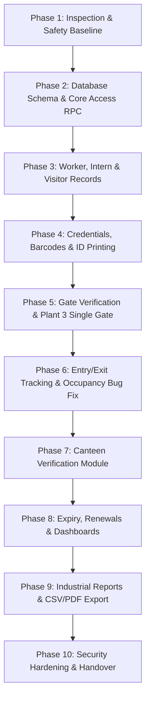

# Initial Assessment: ABB Plant 3 Security System

**Document:** `project info/initial-assessment.md`  
**Date:** October 15, 2026  
**Status:** Completed Analysis (Phase 1) — Awaiting User Approval before Implementation  
**Target:** Conversion of Student Barcode Gate Verification System into ABB Plant 3 Security Gate Verification & ID Management System  

---

## 1. Executive Summary & Existing Application Architecture

### 1.1 Application Overview
The existing project originated as a **Barcode Student Verification System** built for **Arusha Technical College (ATC)** by Dionysius John Kassongo. The current Git branch is `feature/abb-frontend-theme`, where an initial visual foundation for ABB (including `AbbLogo.tsx`, `public/abb-logo.png`, and ABB red `--primary: #ED1C24` theme in `styles.css`) was started.

The project is an existing, functional full-stack web application. It does **not** need to be rewritten from scratch. The existing codebase compiles cleanly: `npm run build` completed successfully, producing both client-side and server-side (SSR) production bundles with zero TypeScript or Vite errors.

### 1.2 Technology Stack
| Layer | Technology | Details / Versions |
|---|---|---|
| **Frontend Framework** | React 19.2.0 + TypeScript 5.8.3 | Modern React with strict typing |
| **Bundler / Server** | Vite 7.3.1 + TanStack Start 1.167.50 | TanStack Start with Cloudflare Pages/Worker adapter (`wrangler.jsonc`) |
| **Routing & State** | `@tanstack/react-router` + `@tanstack/react-query` 5.83 | File-based routing (`src/routes`), server-state caching |
| **Styling & Design** | Tailwind CSS v4.2.1 + Radix UI Primitives | Custom CSS tokens in `src/styles.css` tailored to ABB palette |
| **Backend & DB** | Supabase (`@supabase/supabase-js` 2.105.4) | PostgreSQL database, Auth, Storage, RLS policies |
| **Scanning** | Quagga2 (`@ericblade/quagga2`) + ZXing (`@zxing/browser`) | Hardware USB/Bluetooth scanner input + Camera QR/barcode scanning |
| **ID & PDF Generation** | `jspdf` 4.2.1, `jsbarcode` 3.12.3, `qrcode` 1.5.4 | A4 / A6 card layout, Code 128 barcodes, QR codes |
| **Offline Engine** | IndexedDB via `idb` 8.0.3 | Database `"atc-gate"`, stores cached records and queued scans |
| **Localization** | `i18next` + `react-i18next` | English (`en.json`) and Swahili (`sw.json`) |

---

## 2. Feature-by-Feature Status Inventory

Each feature in the codebase has been inspected at the source code level:

| Feature / Module | Current Implementation File(s) | Status | Detailed Findings & Technical Assessment |
|---|---|---|---|
| **Barcode Scanner Input** | `src/routes/_authenticated/verify.tsx` | **Working** | Auto-focuses text input; handles rapid hardware keyboard-wedge USB/Bluetooth scanners; debounces scans; anti-passback cooldown (15s default); audio beep synthesis via Web Audio API. |
| **Camera-Based Scanning** | `src/routes/_authenticated/verify.tsx` | **Working** | Uses `@ericblade/quagga2` for live barcode detection; properly checks `isSecureContext` (HTTPS / localhost); handles permissions and video element streams. |
| **Emergency Lockdown** | `src/routes/_authenticated/verify.tsx`, `settings` table | **Working** | Admin/operator can activate lockdown mode; writes `lockdown_active: true` to `settings`; immediately denies all access attempts. |
| **Kiosk Mode** | `src/routes/_authenticated/verify.tsx` | **Working** | Fullscreen browser toggle for gate monitor operation. |
| **Manual Identity Lookup** | `src/routes/_authenticated/verify.tsx` | **Working** | Search modal allows fallback lookup by name or admission/ID number with debounced query. |
| **Operator Shift Tracking** | `src/routes/_authenticated/my-shift.tsx`, `shifts` table | **Working** | Operators select gate, start shift, monitor live shift stats (allowed, denied, unknown, visitors), log handover notes, and review history. |
| **Watchlist & Alerts** | `src/routes/_authenticated/watchlist.tsx`, `watchlist` table | **Working** | Supports alert levels (`info`, `warn`, `deny`, `detain`), photo upload to Supabase Storage, active expiry, and automatic deny/detain enforcement during scans. |
| **Incident Management** | `src/routes/_authenticated/incidents.tsx`, `incidents` table | **Working** | 8 incident categories (trespass, theft, suspicious person, medical, damage, altercation, lost ID, other), 4 severity levels, admin review and resolution notes. |
| **Announcements** | `src/routes/_authenticated/announcements.tsx`, `announcements` | **Working** | Priority levels (`low`, `normal`, `high`, `urgent`), expiry dates, and per-user read receipt acknowledgments (`announcement_reads`). |
| **Offline Scanning & Sync** | `src/lib/offline.ts`, `src/routes/_authenticated/verify.tsx` | **Partially Working** | IndexedDB caches records and enqueues scans (`enqueueScan`). However: decisions are made locally from stale cache; watchlist is **not** checked offline; DB name is `"atc-gate"`. |
| **Gate Verification Logic** | `src/routes/_authenticated/verify.tsx` | **Partially Working / Insecure** | Verification rules (status, suspension, expiry) run **entirely in frontend client code**; bypasses database RPC `check_student_card()`. Scans write directly to `access_logs`. |
| **"Who's Inside" Occupancy** | `src/routes/_authenticated/inside.tsx` | **Partially Working** | Computes occupancy by checking `ins > outs` from `access_logs`. Bug: Only queries `gte("scanned_at", localMidnight)`, meaning night-shift entries prior to 00:00 vanish. |
| **Visitor Pass Management** | `src/routes/_authenticated/visitors.tsx`, `appointments.tsx` | **Partially Working** | Can issue visitor passes; prints A6 PDF. However, visitors are stored directly in the `students` table with `is_visitor: true`. Appointments do not auto-generate passes. |
| **ID Card Generation & PDF** | `src/lib/idcard.ts` | **Partially Working** | Generates single and 8-per-A4 PDFs with barcodes. However: uses college green styling (`#145032`), hardcoded "Arusha Technical College", and academic fields (NTA level, Year). |
| **Dashboard** | `src/routes/_authenticated/dashboard.tsx` | **Partially Working** | Shows summary cards and hourly activity charts. However: lacks plant filtering; route has **no** `isAdmin` guard (non-admin operators can navigate directly to `/dashboard`). |
| **Settings Management** | `src/routes/_authenticated/settings.tsx` | **Partially Working** | Session timeout and access hours work, but UI still contains college settings (`college_name`, `notify_parents_enabled`). |
| **User & Role Management** | `src/routes/_authenticated/users.tsx`, `user_roles` | **Working** | Allows admins to assign roles. However: roles are limited to enum `('admin', 'gate')`; no `canteen` role exists. |
| **Public Kiosk Verification** | `src/routes/check.tsx` | **Risky / Inappropriate** | Public route allowing anonymous card checks via `check_student_card` RPC without login. Major data privacy leak for an industrial plant. |
| **Contract Worker Management** | N/A | **Missing** | No dedicated worker registration, contractor company field, or contractor pass workflow. |
| **Internship Student Records** | N/A | **Missing** | No dedicated intern registration form, institution field, or supervisor contact. |
| **Plant 3 Configuration** | N/A | **Missing** | No `plants` table; gates and logs have no `plant_id`. |
| **Canteen Verification** | N/A | **Missing** | No canteen route, no canteen transaction table, no duplicate-use-per-day enforcement. |
| **Corporate Security Reports** | `src/routes/_authenticated/reports.tsx` | **Missing / Misaligned** | Existing reports are 100% academic attendance (present, absent, late by student programme). Corporate gate/plant reports do not exist. |
| **Automated Expiry Reminders** | `src/routes/_authenticated/notifications.tsx` | **Missing Backend** | UI is a read-only viewer for `notifications` table. No background Edge Functions or email dispatchers exist. |

---

## 3. Review & Summary of Reference Documents

### 3.1 Document Inventory & Filename Clarifications
During Phase 1 discovery, all reference files were inspected. Notice the following exact file paths and names:
1. `project info/PRD.md`: Present. Product Requirements Document v1.0.
2. `project info/Architecture.md`: Present. Architecture & Implementation Guidance v1.0.
3. `project info/memory.md`: Present. Project Memory & Operating Baseline v1.0.
4. `project info/phase.md`: Present (internally titled `# phases.md`). Development Phases v1.0.
5. `project info/writing-block.md`: Present (internally titled `# rules.md\n# ABB Plant 3 Security System — Business Rules`).
6. `project info/requirement pdf for friend.docx`: Present (Word `.docx` format, not `.pdf`).

### 3.2 Key Takeaways from Reference Documents
- **`PRD.md`**: Stresses that this is an adaptation of an existing system, not a rewrite. Initial scope is strictly **ABB Plant 3**. Core audiences: Contract/Temporary Workers, Internship Students, Visitors. Forbids silent approvals on failures. Requires backend-enforced authorization and auditable validity/renewal lifecycle.
- **`Architecture.md`**: Retains React, TypeScript, and Supabase. Establishes the authoritative backend principle (database RLS and server logic must enforce rules, not frontend alone). Maps out data entities for Plants, Gates, People, Passes, Gate Events, Canteen Events, and Audit Logs.
- **`rules.md` (in `writing-block.md`)**: Establishes 3 explicit outcomes: `APPROVED`, `REJECTED`, `UNABLE TO VERIFY`. Mandates separate entry and exit events. Default expiry notification at 7 days. Default canteen rule: 1 successful meal per person per calendar day. Prohibits hard deletion of access history.
- **`phase.md` (in `phase.md`)**: Lays out a 12-phase incremental plan: Safety Inspection & Baseline -> Branding -> Auth/Roles -> People Records -> Credentials -> Gate Verification -> Expiry/Renewal -> Canteen -> Dashboards/Reports -> Offline -> Testing -> Deployment.
- **`memory.md`**: Details non-negotiable safety rules, design principles, and instructions for subsequent development sessions.
- **`requirement pdf for friend.docx`**: Adds crucial real-world context:
  - Explicit physical constraint: `***** there is only one gate in pant 3 *********`.
  - Photo is explicitly marked as `(optional)`.
  - Stresses portrait ID cards and simple registration for security guards.
  - Prioritizes contract workers with contractor company name.

---

## 4. Requirements Comparison, Conflicts & Recommended Resolutions

| Item / Requirement | Document A (PRD / Rules) | Document B (Friend Requirements / Code) | Conflict / Gap | Recommended Sensible Resolution |
|---|---|---|---|---|
| **Gate Count for Plant 3** | PRD & Architecture specify multi-gate selection and management. | Friend Requirement Section 10: `***** there is only one gate in pant 3 *********`. | Potential conflict in UI workflow (forcing gate selection vs single gate). | **Resolution:** Retain the generic `gates` database schema with `plant_id`, but seed Plant 3 with exactly one active gate: `"Plant 3 - Main Gate"`. Pre-select this gate in verification and scanning screens so security operators do not need to pick a gate on every shift, while keeping the data architecture multi-gate ready. |
| **Photograph Requirement** | PRD states photo capture/upload where permitted by policy. | Friend Requirement Section 4 & 6: "Photograph (optional)". | Must photo be mandatory? | **Resolution:** Make photo upload optional during worker, intern, and visitor registration. If provided, render the photo on card and scan screen; if omitted, display a clean ABB initials badge / neutral avatar. |
| **Public Card Check Route (`/check`)** | PRD Section 16 & Rules Section 17 mandate authenticated access and data protection. | Codebase includes `/check` allowing anonymous barcode queries. | Public endpoint leaks personal info and card status in an industrial setting. | **Resolution:** Disable or gate `/check`. For an industrial security system, card checks must be performed by authenticated staff on `/verify`. |
| **People Data Model** | Architecture suggests unified Person entity with category. | Existing database uses `students` table with `is_visitor` boolean and academic fields. | Destructive schema overhaul vs schema reuse. | **Resolution:** Incrementally extend `students` table (or create a unified view `people`) by adding `category` ('worker', 'intern', 'visitor'), `company_name`, `institution`, and `plant_id`. Keep existing table structure to avoid breaking migrations, while cleanly retiring college fields. |
| **Access Decision Authority** | Rules Section 5 & Architecture Section 8 mandate server/database-authoritative decisions. | Existing `verify.tsx` evaluates access status in client React state. | Client-side decisions can be bypassed or tampered with. | **Resolution:** Introduce a PostgreSQL function `verify_gate_access(p_code, p_gate_id, p_direction)` that validates existence, status, plant assignment, validity dates, and watchlist, returning `approved`, `rejected`, or `unable_to_verify` with an authoritative reason and atomically inserting into `access_logs`. |
| **Canteen Rule Concurrency** | PRD Section 11 & Rules Section 9 mandate database-level prevention of concurrent duplicate scans. | Feature currently does not exist. | Race condition risk if two scanners scan simultaneously. | **Resolution:** Create `canteen_logs` table with a unique composite index or constraint on `(person_id, log_date)` where `status = 'allowed'`. This guarantees atomic duplicate prevention at the database level regardless of network timing. |
| **Offline Verification vs Fail-Closed** | Rules Section 14: Default safe behavior is `UNABLE TO VERIFY` until ABB approves offline policy. | Existing `offline.ts` gives `allowed` decisions from stale IndexedDB cache. | Safety risk: Revoked or suspended workers may enter offline. | **Resolution:** Support offline scan buffering (`enqueueScan`), but when offline, flag the decision distinctly as `UNABLE TO VERIFY (OFFLINE)` or `OFFLINE_RECORDED` per configurable ABB policy, rather than issuing a standard green approved status. |

---

## 5. Existing Components & Database Structures to Reuse

### 5.1 Reusable UI Components & Libraries
- **`src/components/AbbLogo.tsx`**: High-quality ABB brand logo component already configured.
- **`src/components/ScannerStatus.tsx`**: Detects and indicates physical USB barcode scanner connection.
- **`src/components/BulkImportDialog.tsx`**: CSV parser and batch loader (ready for worker/intern roster imports).
- **`src/components/LanguageSwitcher.tsx`**: Multi-language toggle supporting English and Swahili.
- **`src/components/ui/*`**: Complete Radix UI suite (Dialog, Select, Table, Badge, Switch, Tabs, Sonner Toast).
- **`src/lib/use-idle-timeout.ts`**: Session timeout hook for security operator stations.
- **`src/lib/auth-context.tsx`**: Auth provider with role loading, batching, and error boundary safety.

### 5.2 Reusable Screens & Workflows
- **`src/routes/_authenticated/incidents.tsx`**: Fully reusable for security incidents at Plant 3.
- **`src/routes/_authenticated/watchlist.tsx`**: High-value security feature for Plant 3 security alerts and detention triggers.
- **`src/routes/_authenticated/announcements.tsx`**: Reusable for security guard briefings and shift announcements.
- **`src/routes/_authenticated/my-shift.tsx`**: Shift clocking and handover notes for gate personnel.
- **`src/routes/_authenticated/logs.tsx`**: Access log search, date filtering, live Supabase subscription, and CSV export.

### 5.3 Database Tables & Structures to Reuse
- **`profiles` & `user_roles`**: Core user accounts and RBAC model.
- **`gates`**: Access points (to be linked with Plant 3).
- **`students`**: Base person repository (to be extended with `category`, `company_name`, `plant_id`).
- **`access_logs`**: Historical scan record (direction, gate, operator, decision, reason).
- **`incidents`**: Security incident tracking.
- **`watchlist`**: Restricted/detained individual registry.
- **`announcements` & `announcement_reads`**: Guard notices.
- **`shifts`**: Gate operator shift logs.
- **`settings`**: Key-value system configuration.
- **Supabase Storage Bucket `student-photos`**: Protected bucket for ID card photographs.

---

## 6. Security & Data Integrity Risks

1. **Client-Side Verification Decisions (High Risk):**  
   In `src/routes/_authenticated/verify.tsx`, the verification logic checks expiration and status in browser JavaScript and writes directly to `access_logs`. A browser console script or network proxy could insert `decision: "allowed"` without authorization.  
   *Mitigation:* Create a PostgreSQL RPC function `verify_gate_access` that executes within the database with trusted server timestamp.
2. **Permissive RLS Policy on `access_logs` (High Risk):**  
   - `create policy "Staff can update access logs"` allows any authenticated gate user to modify existing log entries.  
   - `create policy "Admins can delete access logs"` allows hard deletion of audit records.  
   *Mitigation:* Revoke `UPDATE` and `DELETE` on `access_logs` for all non-service roles to enforce append-only audit trails.
3. **Anonymous Information Disclosure on `/check` (Medium Risk):**  
   `check.tsx` calls `public.check_student_card(p_code)` which is granted to `anon` (line 489 of `schema.sql`). Anyone with network access can enumerate barcode IDs and discover names and statuses.  
   *Mitigation:* Revoke `anon` execute permission on `check_student_card` and restrict verification to authenticated operators.
4. **Offline Watchlist Blind Spot (Medium Risk):**  
   `verify.tsx` skips the watchlist check when `!online`. If a worker is blacklisted on the server, a client in offline mode would approve them from local cache.  
   *Mitigation:* Include active watchlist entries in the offline cache or set offline outcome to unverified for non-standard passes.
5. **Session Expiry & Stale Cache on Night Shifts (Low/Medium Risk):**  
   `inside.tsx` filters logs strictly by `gte("scanned_at", localMidnight)`. Shifts crossing midnight drop earlier entries, showing incorrect occupancy counts.  
   *Mitigation:* Refactor occupancy query to check the latest scan direction per person across a rolling 24-48 hour window.

---

## 7. Phased Implementation Plan

### Phase Details

#### Phase 1: Inspection, Safety Baseline & Architecture Mapping (Current Task)
- Thorough inspection of codebase, build verification, documentation analysis, and risk assessment.
- Outcome: `project info/initial-assessment.md` created. Zero destructive changes.

#### Phase 2: Database Schema Extension & Backend Verification Hardening
- Create non-destructive SQL migration script for Supabase:
  - Add `plants` table and seed Plant 3.
  - Add `plant_id` to `gates` table and seed `"Plant 3 - Main Gate"`.
  - Add `category` (`'worker'`, `'intern'`, `'visitor'`), `company_name`, `institution`, and `plant_id` to `students` table.
  - Create `canteen_logs` table with unique constraint on `(person_id, log_date)`.
  - Create secure PostgreSQL RPC function `verify_gate_access` to make access decisions authoritatively on the database server.
  - Tighten RLS policies on `access_logs` (append-only).

#### Phase 3: Worker, Intern & Visitor Management Redesign
- Adapt `src/routes/_authenticated/students.index.tsx` and `students.$id.tsx` into a unified Person/Credential Management interface:
  - Worker tab: Full Name, Worker ID, Contractor Company, Validity Range, Plant 3, Optional Photo.
  - Intern tab: Full Name, Intern ID, College/Institution, Validity Range, Plant 3, Optional Photo.
  - Visitor pass generation: Link with `appointments` and visitor form.
- Keep forms short, responsive, and easy for security staff.

#### Phase 4: ABB ID Card & Pass Generation
- Refactor `src/lib/idcard.ts`:
  - Replace college green headers with approved ABB red/white theme.
  - Replace "Arusha Technical College" with "ABB Plant 3 Security".
  - Support portrait ID format with clear category badges (Contract Worker / Intern / Visitor Pass).
  - Handle optional photo gracefully (render photo if present; clean initials avatar if absent).
  - Include Code 128 barcode and valid date range.

#### Phase 5: Gate Verification Interface & Single Gate Workflow
- Update `src/routes/_authenticated/verify.tsx`:
  - Automatically bind to `"Plant 3 - Main Gate"`.
  - Call the database RPC `verify_gate_access` instead of evaluating access client-side.
  - Display clear, high-contrast ABB outcomes: **ENTRY APPROVED (Green)**, **ENTRY REJECTED (Red)**, **UNABLE TO VERIFY (Amber)** with clear failure reasons.
  - Preserve USB scanner listening, camera scanning, lockdown toggle, and audio beeps.

#### Phase 6: Entry/Exit Tracking & 24h Occupancy Fix
- Refactor `src/routes/_authenticated/inside.tsx`:
  - Fix midnight cutoff bug by looking at the most recent entry event per person across a configurable 36-hour window.
  - Display category breakdown: Workers inside, Interns inside, Visitors inside.
  - Add filter by contractor company and institution.

#### Phase 7: Canteen Verification Module
- Implement `/canteen` route:
  - Rapid barcode scan interface dedicated to canteen staff.
  - Verifies eligibility and enforces the one-meal-per-calendar-day rule using the database constraint.
  - Immediately rejects duplicate scans on the same day with clear feedback.
  - Records canteen events with timestamp, operator, and meal date.

#### Phase 8: Expiry Enforcement, Renewals & Dashboard
- Implement expiry checks in verification and dashboard:
  - Upcoming expiries (7-day window) and expired cards list on `/dashboard`.
  - Administrative extension/renewal modal with mandatory reason and audit logging.
  - Fix route guard on `/dashboard` so non-admin operators are redirected to `/verify`.

#### Phase 9: Industrial Security Reports & Data Export
- Replace academic attendance in `src/routes/_authenticated/reports.tsx` with operational security reports:
  - Daily Gate Activity (entries, exits, peak hours).
  - Currently Inside / Missing Exit report.
  - Active Contract Workers by Company.
  - Visitor Pass Log.
  - Canteen Usage & Duplicate Attempt Report.
  - Rejection & Watchlist Incident Report.
  - CSV and PDF export capability with role-based filtering.

#### Phase 10: Security Hardening, Offline Polish & Verification
- Remove or restrict public `/check` route.
- Remove legacy college settings from `/settings`.
- Verify offline queuing behavior and reconciliation.
- Complete regression test suite and document configuration for deployment.

---

## 8. Recommended First Implementation Task

**Recommended Task: Phase 2.1 — Supabase Schema Migration Script for Plant 3 Foundation**

### Why this task first?
Before changing frontend forms or scanner code, the underlying database must safely support the required entities (`plants`, `plant_id`, categories `worker`/`intern`/`visitor`, and `canteen_logs`), and the authoritative verification RPC `verify_gate_access` must be established. 

### Scope of Task 2.1:
1. Prepare a non-destructive SQL migration script (e.g., `supabase/migrations/001_abb_plant3_foundation.sql`).
2. Add `plants` table with default row: `('Plant 3', 'PLANT-3', true)`.
3. Add `plant_id` foreign key to `gates` table and seed `"Plant 3 - Main Gate"`.
4. Add `category` enum `('worker', 'intern', 'visitor')`, `company_name`, and `institution` to `students` table without dropping existing columns.
5. Create `canteen_logs` table with composite unique index `(person_id, log_date)` for atomic duplicate prevention.
6. Create PostgreSQL RPC `verify_gate_access(p_code, p_gate_id, p_direction)` returning structured access decisions.
7. Present the migration SQL for your review and approval before running it.

---

## 9. Key Decisions Requiring Approval

Before modifying code or database schema, please review and confirm the following key decisions:

1. **Plant 3 Single Gate Confirmation:**  
   Confirm that Plant 3 currently has **one physical gate**, allowing us to default the verification interface to `"Plant 3 - Main Gate"` without requiring security staff to select a gate each time.
2. **Schema Extension Strategy (Preserving Existing Table):**  
   Confirm that extending the existing `students` table (adding `category`, `company_name`, `plant_id`, etc.) is acceptable to preserve existing data, relationships, and RLS policies without a risky table rewrite.
3. **Public Kiosk Route (`/check`):**  
   Confirm that the public `/check` route should be **disabled or restricted behind authentication** to prevent unauthorized scanning/scraping of worker names and credentials.
4. **Access Logs RLS Hardening (Append-Only):**  
   Confirm that `UPDATE` and `DELETE` on `access_logs` should be revoked for gate operators to guarantee an immutable security audit trail.
5. **Canteen Daily Allowance & Timezone:**  
   Confirm that the initial canteen limit is **one entry/meal per person per calendar day**, and confirm the local site timezone for daily reset (e.g., `Asia/Kolkata` for India or appropriate ABB site timezone).
